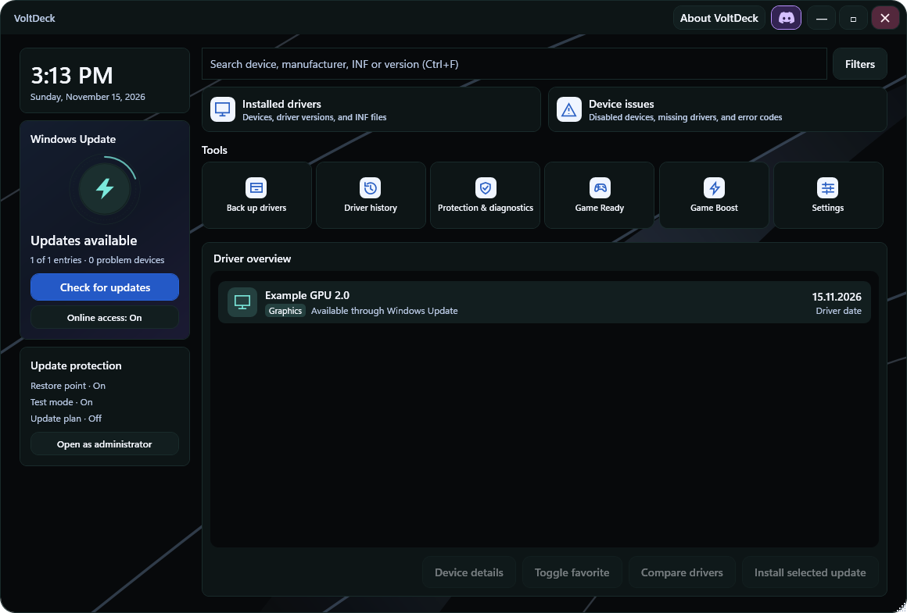
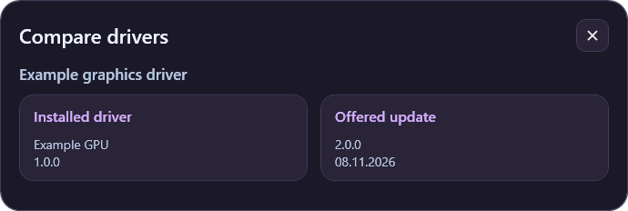
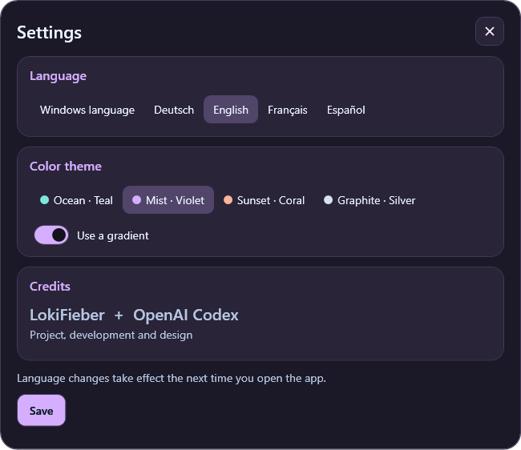
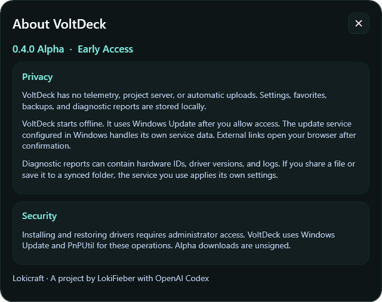

# VoltDeck

VoltDeck is an Early Access driver utility for Windows 10 and 11 (x64). It finds compatible drivers through Windows Update, compares installed and offered versions, and keeps a local record of driver changes. The Rust launcher opens a WPF desktop interface. VoltDeck uses Windows PowerShell 5.1 for device queries and PnPUtil for driver exports and imports. See the [0.4.0 Alpha release notes](RELEASE-NOTES.md).

## Download

Choose a package from the [Releases page](../../releases).

- **Setup** installs VoltDeck for the current Windows account and adds a Start menu entry. A desktop shortcut is optional.
- **Portable** runs from a writable folder. Extract the entire ZIP, keep `portable.flag` beside `VoltDeck.exe`, and open the EXE. Settings, driver history, and automatic backups are stored under `data/`.
- **SHA256SUMS.txt** contains the SHA-256 checksums for both packages.

Cargo is only needed when building from source. The Early Access builds are unsigned, so Windows may display an unknown publisher prompt.

## Screenshots



The dashboard and comparison use sample driver data. The dashboard shows online access after it has been enabled for the session.

<details>
<summary>Driver comparison and appearance settings</summary>





</details>

## Drivers and recovery

- **Check for updates** lists compatible packages offered by the Windows Update service configured on your PC. Driver cards distinguish the driver's reported date from the Windows Update catalog date.
- **Compare drivers** shows the installed and offered versions side by side when Windows supplies enough information to match them.
- **Driver history** records update attempts, comparisons, and results. Before installing an update, VoltDeck attempts to export the existing OEM package when it can identify it.
- **Restore backup** imports an INF from an existing backup. Windows applies its own driver ranking when selecting the active package, so importing an older package may leave the current driver active.
- **Open as administrator** is required to prepare or install updates and export or restore drivers. After reopening as administrator, run the scan again to select an update.

## Protection and diagnostics

- **Test mode** checks whether Windows Update has cached the full package and asks separately before installing it. You can also require a fresh system restore point. If Windows does not confirm one, VoltDeck stops the installation.
- **Full driver backup** exports third-party packages to a location you choose and checks their SHA-256 manifest. Use **Verify backup** to check a saved copy. Windows decides whether an imported package becomes active.
- **Device details** shows hardware IDs, known affected devices, INF files, driver dates, provider and signer information reported by Windows, and the Driver Store path when available. Use **Check Windows rollback** to open the device's Windows property sheet.
- **Device issues** lists devices with Windows problem codes, including disabled devices and missing drivers. **Export diagnostics** creates standalone HTML and JSON with local device and driver details, Windows version, and recent VoltDeck history.
- **Ctrl+F** searches device names, manufacturers, INF files, and versions. Filters narrow the current list, and favorites stay near the top. The relevant-drivers filter uses Windows' published OEM INF naming to hide likely inbox drivers while retaining problem devices and favorites.
- **Update plans** can check daily or weekly while VoltDeck is open. A scheduled scan checks Windows Update and displays a notification when it finds offers.

## Privacy and security

VoltDeck starts with online access off each time it opens. You can allow Windows Update for the current session, including scheduled scans, using the control on the dashboard. Windows uses the update service configured on your PC, which can process device and configuration data. The CLI requires explicit online access for each scan, preparation, or installation command.

VoltDeck has no telemetry, project server, or automatic uploads. Its settings, favorites, driver history, backups, and diagnostic exports live on disk. Installed builds store app data under the current user's local AppData. The portable edition uses the data folder next to the EXE. Backup and diagnostic actions reject network drives and redirects. A separate synchronization tool can still upload files from folders it manages.

Diagnostic reports can contain hardware identifiers, driver metadata, and recent activity. Exports stay on disk unless you choose to share them. Links to Discord and vendors open in your browser after confirmation from a standard VoltDeck window.

The **About VoltDeck** dialog shows the release version and explains online access, local storage, and administrator permissions. Alpha downloads are unsigned.



## Gaming

**Game Ready** links to official driver and game component resources from NVIDIA, AMD, Intel, and Microsoft. The separate automatic installation option requires administrator privileges and test mode to be off. It only handles explicitly labeled NVIDIA Game Ready packages that require no interaction and whose license terms have already been accepted. The critical-driver lock excludes graphics, network, storage, chipset, audio, and unclassified drivers from this option.

**Game Boost** lists visible apps and their memory use. It sends a standard close request to the apps you select, giving them a chance to ask you to save your work. The installed edition can optionally add a desktop context menu shortcut.

## Appearance and languages

Settings offers four color themes, a gradient toggle, and Light, Dark, or Windows appearance. When available, VoltDeck uses the Windows display language by default. German and English include the new interface text. French and Spanish fall back to English for missing strings. To add a translation, place a UTF-8 language file in the locales folder beside VoltDeck.exe and follow the structure of an entry in [the locale catalog](src/locales/additional.json). Windows diagnostics and vendor-provided text may retain their original language.

## Build from source

Use a Windows Rust toolchain with Rust 1.79 or later. Run these commands from the repository root.

```powershell
.\build-desktop.ps1
.\target\release\VoltDeck.exe
```

The desktop build script embeds the app icon and sets **Lokicraft** in the Windows file metadata. A verified UAC publisher requires a trusted Authenticode signature on the finished EXE.

To build the installer and portable ZIP, use Inno Setup 6.7.4 and run `.\build-release.ps1`. If `ISCC.exe` is outside your PATH, pass its path with `-Compiler`. The script writes both packages and their checksums to `dist/`. The [Windows workflow](.github/workflows/windows.yml) builds the desktop EXE as a GitHub Actions artifact.

### Command-line interface

```powershell
cargo build --release --bin driver-tool
.\target\release\driver-tool.exe --help
.\target\release\driver-tool.exe inventory
.\target\release\driver-tool.exe problems
.\target\release\driver-tool.exe scan --online
```

To install from an administrator terminal, substitute the update ID and revision returned by `scan`. The `--accept-eula` flag accepts the selected update's license terms. For a driver export, supply a new destination folder.

```powershell
.\target\release\driver-tool.exe install 12345678-1234-1234-1234-123456789abc 200 --accept-eula --online
.\target\release\driver-tool.exe backup '.\Driver-Backup'
```

## Credits

LokiFieber and OpenAI Codex. [Join the Discord community](https://discord.gg/8JGu5Ecerh).
