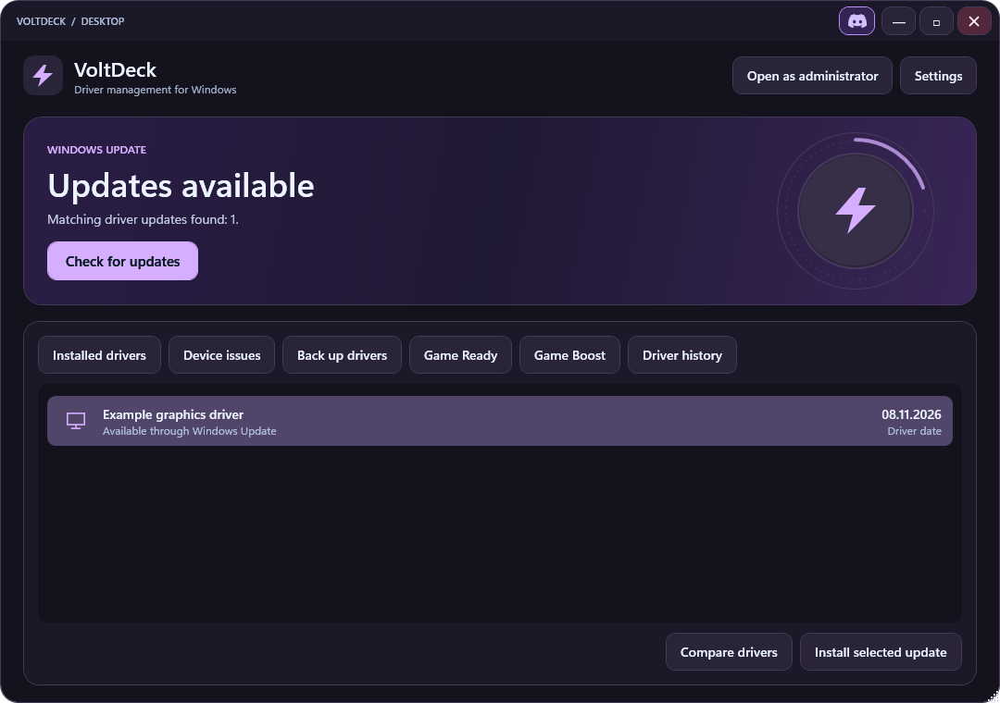
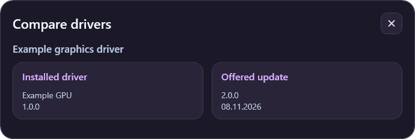
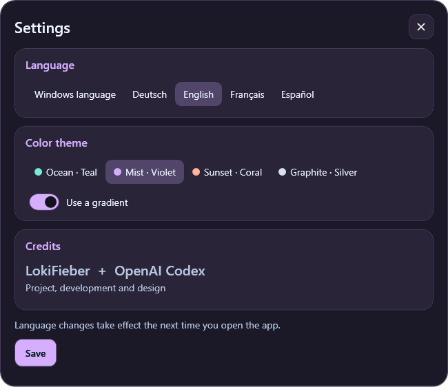

# VoltDeck

VoltDeck is an Early Access driver utility for Windows 10 and 11 (x64). It finds compatible drivers through Windows Update, compares installed and offered versions, and keeps a local record of driver changes. The Rust launcher opens a WPF desktop interface. VoltDeck uses Windows PowerShell 5.1 for device queries and PnPUtil for driver exports and imports.

## Download

Choose a package from the [Releases page](../../releases).

- **Setup** installs VoltDeck for the current Windows account and adds a Start menu entry. A desktop shortcut is optional.
- **Portable** runs from a writable folder. Extract the entire ZIP, keep `portable.flag` beside `VoltDeck.exe`, and open the EXE. Settings, driver history, and automatic backups are stored under `data/`.
- **SHA256SUMS.txt** contains the SHA-256 checksums for both packages.

Cargo is only needed when building from source. The Early Access builds are unsigned, so Windows may display an unknown publisher prompt.

## Screenshots



The dashboard and comparison use sample driver data.

<details>
<summary>Driver comparison and appearance settings</summary>





</details>

## Drivers and recovery

- **Check for updates** lists compatible packages offered by the Windows Update service configured on your PC. Driver cards distinguish the driver's reported date from the Windows Update catalog date.
- **Compare drivers** shows the installed and offered versions side by side when Windows supplies enough information to match them.
- **Driver history** records update attempts, comparisons, and results. Before installing an update, VoltDeck attempts to export the existing OEM package when it can identify it.
- **Restore backup** imports an INF from an existing backup. Windows applies its own driver ranking when selecting the active package, so importing an older package may leave the current driver active.
- **Open as administrator** is required to install updates and export or restore drivers. After reopening as administrator, run the scan again to select an update.

## Gaming

**Game Ready** links to official driver and game component resources from NVIDIA, AMD, Intel, and Microsoft. The optional automatic installation checks Windows Update every 30 minutes while the administrator window is active. It only handles explicitly labeled NVIDIA Game Ready packages that require no interaction and whose license terms have already been accepted.

**Game Boost** lists visible apps and their memory use. It sends a standard close request to the apps you select, giving them a chance to ask you to save your work. The installed edition can optionally add a desktop context menu shortcut.

## Appearance and languages

Settings offers four color themes, a gradient toggle, and German, English, French, and Spanish. When available, VoltDeck uses the Windows display language by default. To add a translation, place a UTF-8 `locales/<language-code>.json` file beside `VoltDeck.exe`. Follow the `name` and `strings` structure of a language entry in [the locale catalog](src/locales/additional.json). Missing strings fall back to English. Windows diagnostics and vendor-provided text may retain their original language.

## Build from source

Use a Windows Rust toolchain with Rust 1.79 or later. Run these commands from the repository root.

```powershell
.\build-desktop.ps1
.\target\release\VoltDeck.exe
```

The desktop build script embeds the app icon and sets **Lokicraft** in the Windows file metadata. A verified UAC publisher requires a trusted Authenticode signature on the finished EXE.

To build the installer and portable ZIP, use Inno Setup 6.7.4 and run `.\build-release.ps1`. If `ISCC.exe` is outside your PATH, pass its path with `-Compiler`. The script writes both packages and their checksums to `dist/`. The [Windows workflow](.github/workflows/windows.yml) builds the desktop EXE as a GitHub Actions artifact.

### Command-line interface

```powershell
cargo build --release --bin driver-tool
.\target\release\driver-tool.exe --help
.\target\release\driver-tool.exe inventory
.\target\release\driver-tool.exe problems
.\target\release\driver-tool.exe scan
```

To install from an administrator terminal, substitute the update ID and revision returned by `scan`. The `--accept-eula` flag accepts the selected update's license terms. For a driver export, supply a new destination folder.

```powershell
.\target\release\driver-tool.exe install 12345678-1234-1234-1234-123456789abc 200 --accept-eula
.\target\release\driver-tool.exe backup '.\Driver-Backup'
```

## Credits

LokiFieber and OpenAI Codex. [Join the Discord community](https://discord.gg/8JGu5Ecerh).
